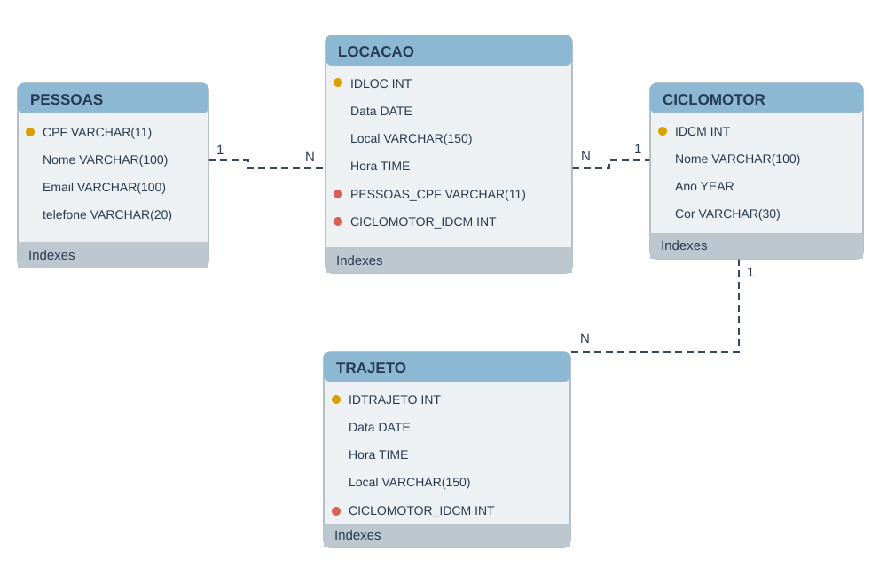

# 🛵 MoveRent — Banco de Dados de Locação de Ciclomotores

Projeto acadêmico de modelagem relacional e análise de dados com **MySQL** e **MySQL Workbench**, simulando cadastros de clientes, ciclomotores e locações.

## Visão geral

O projeto contém quatro tabelas relacionadas:

| Tabela | Descrição | Chave primária |
|---|---|---|
| `pessoas` | Clientes | `CPF` |
| `ciclomotor` | Veículos | `IDCM` |
| `locacao` | Locações entre clientes e veículos | `IDLOC` |
| `trajeto` | Registro de trajetos vinculados a veículos | `IDTRAJETO` |

As chaves estrangeiras conectam `locacao` a `pessoas` e `ciclomotor`, e `trajeto` a `ciclomotor`.

## Diagrama entidade-relacionamento



## Dados de exemplo

O backup possui **6 clientes, 5 ciclomotores e 8 locações fictícias**. A tabela `trajeto` tem estrutura definida, mas ainda não contém dados.

## Consultas SQL

O arquivo [consultas.sql](consultas.sql) demonstra análise de locações por cliente, utilizando `INNER JOIN`, `COUNT`, `GROUP BY` e `ORDER BY`.

```sql
SELECT
    pessoas.Nome AS Cliente,
    COUNT(locacao.IDLOC) AS Total_Locacoes
FROM pessoas
INNER JOIN locacao
    ON pessoas.CPF = locacao.PESSOAS_CPF
GROUP BY pessoas.CPF, pessoas.Nome
ORDER BY Total_Locacoes DESC;
```

## Como executar

1. Instale o MySQL Server 8.0 e o MySQL Workbench pelo [site oficial](https://dev.mysql.com/downloads/).
2. Conecte-se a um servidor MySQL pelo Workbench.
3. Abra **Server → Data Import → Import from Self-Contained File**.
4. Escolha `moverent_backup.sql` e execute a importação para criar o banco `mydb`.
5. Abra e execute `consultas.sql`.

> **Atenção:** o backup contém comandos `DROP TABLE IF EXISTS`, que podem substituir tabelas existentes de mesmo nome no banco de destino. Use um ambiente de testes.

## Arquivos

- `moverent_backup.sql`: estrutura, relacionamentos e dados fictícios.
- `consultas.sql`: consultas analíticas.
- `MoveRent_DER.svg`: diagrama relacional em formato vetorial.
- `README.md`: documentação.

## Aprendizados

Modelagem entidade-relacionamento, chaves primárias e estrangeiras, `INSERT`, `SELECT`, `DELETE`, `JOIN`, `COUNT`, `GROUP BY` e `ORDER BY`.

**Status:** projeto acadêmico funcional para demonstração e aprendizado.
